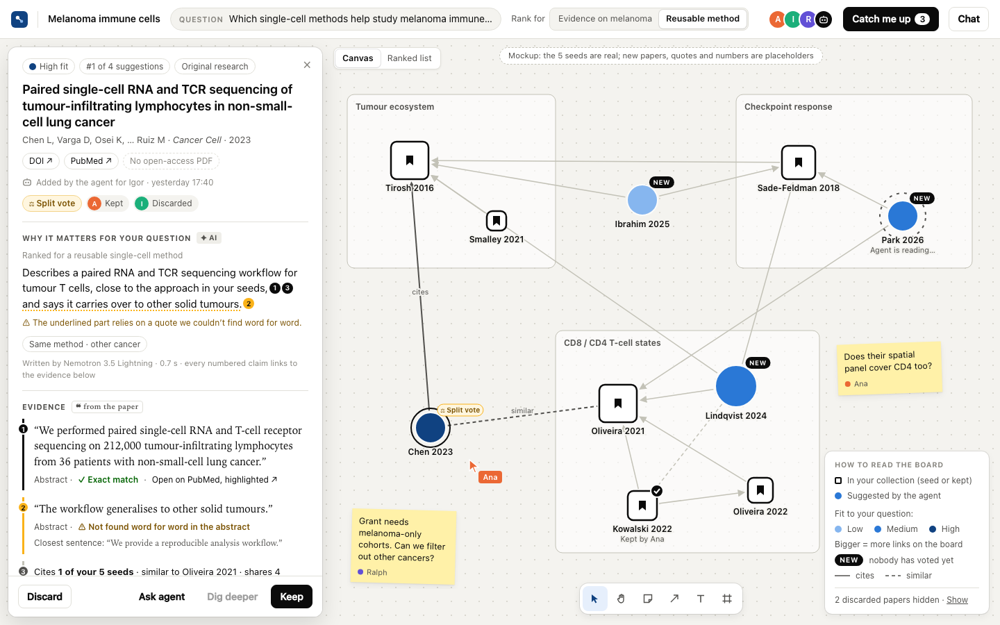
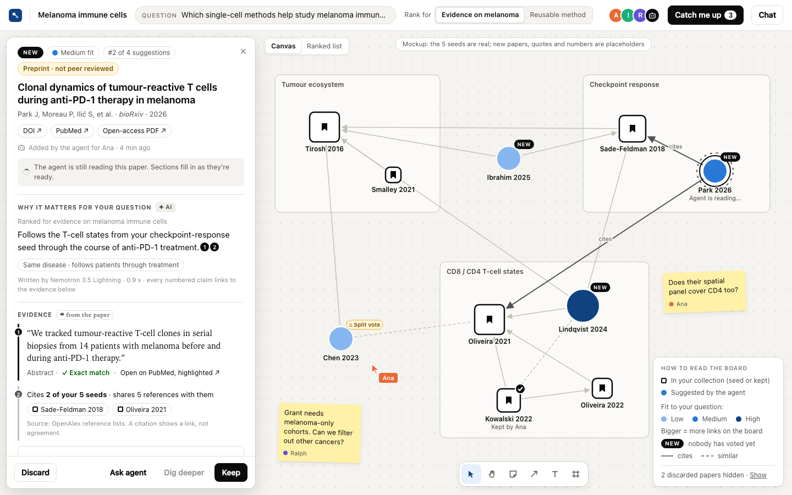
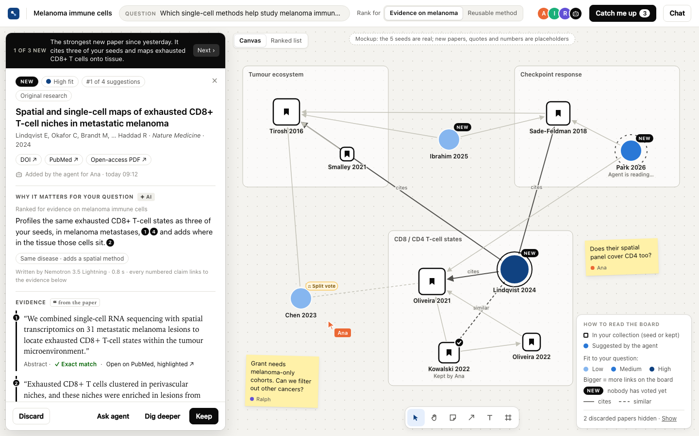
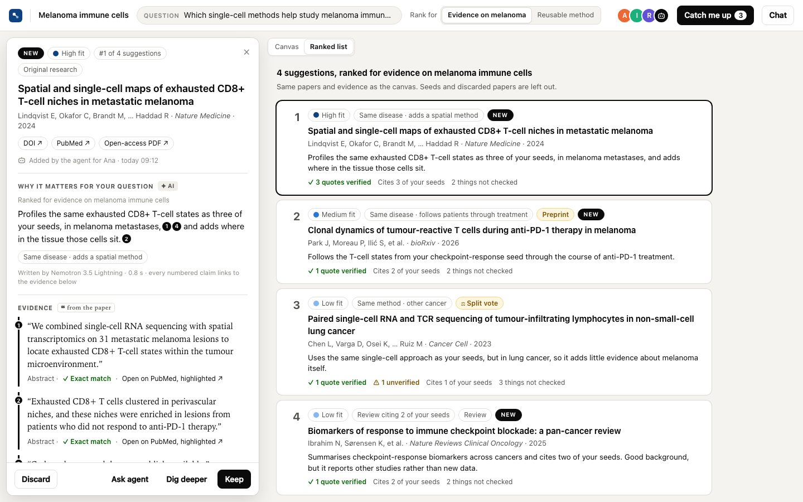
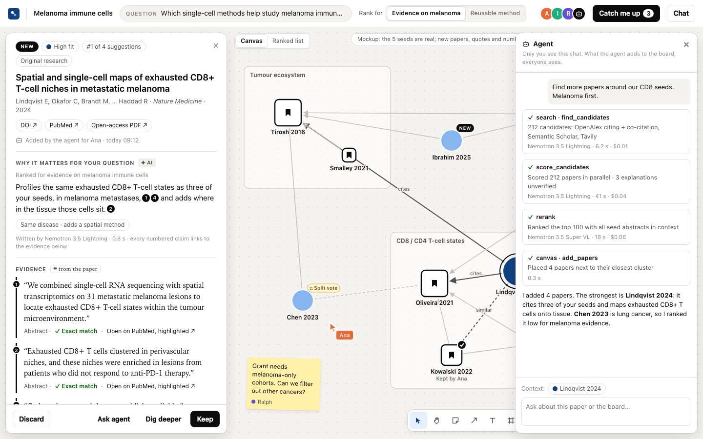

# New-paper card mockup

A clickable mockup of the canvas and the panel for a new paper (Flow 3 in [Concept.md](../Concept.md)). Download [`paper-panel.html`](paper-panel.html) and open it in a browser. It's one self-contained file with no build step.

**Placeholder data.** The five seeds are the brief's example papers (metadata from OpenAlex). The new papers, quotes, timings and costs are made up.

## What to try

- Click the new papers to see each card state:
  - **Lindqvist 2024:** the full card, with a figure.
  - **Chen 2023:** a split vote, an unverified quote, and no open-access PDF, so it shows its links instead of a figure.
  - **Park 2026:** a preprint the agent is still reading, with loading states.
  - **Ibrahim 2025:** a review.
- In the panel, hover a seed chip or a numbered marker. It highlights the seed on the canvas or the matching evidence.
- Switch **Rank for** between evidence and method. The colours, the ranking and the "why" text change.
- Try **Catch me up**, **Ranked list**, **Keep** and **Discard** (both with Undo), and **Chat**.
- Deep links: `#sel=n2&goal=method`, `#view=list`, `#chat=1`, `#catchup=1`.

## Panel layout

The order follows the keep-or-discard decision:

1. **What it is:** title, authors, venue, year, DOI, PubMed, PDF, and paper type (review, preprint).
2. **Why it matters:** one or two AI-written sentences. Each claim carries a number that points to its evidence. The relation tag reads like "Same method · other cancer".
3. **Evidence from the paper:**
   - verbatim quotes, marked ✓ exact match or ⚠ not found;
   - the seeds it cites;
   - a real figure, or, without an open-access PDF, its links on the board.
4. **Couldn't check:** what the agent couldn't assess.
5. **On this board:** cluster, links, closest paper in the collection, and how it was found.
6. **Folded away:** the AI summary next to the original abstract, and notes.
7. **Pinned buttons:** Discard, Ask agent, Dig deeper, Keep.

Text taken from the paper is set in serif and links to its source. Text written by AI carries an "AI" tag and its model and time.

## What the card needs from the backend

These go beyond the Paper record in Concept.md:

- `relevance.claims[]` with evidence IDs, so each sentence links to a quote or citation. A sentence with no evidence is dropped or flagged.
- `relevance.quotes[]`: several quotes, each with `verified`, instead of one `quote`.
- `relevance.gaps[]`: what couldn't be checked.
- `relevance.relation` and the `goal` the ranking used.
- `type` (article, review or preprint), from OpenAlex.
- `summary.tldr` and per-section progress, so each section can fill in on its own.
- The model and time for each step, for the labels.

## Not in the mockup yet

Concept.md has since changed the panel into a zoom-in overlay (a small sub-board for the paper) with the PDF and highlights. The mockup shows a fixed panel without the zoom or the PDF. Filters, "structure by", and quote and figure shapes on the canvas are also missing.

## Screenshots

| | |
|---|---|
|  |  |
|  |  |
|  |  |
