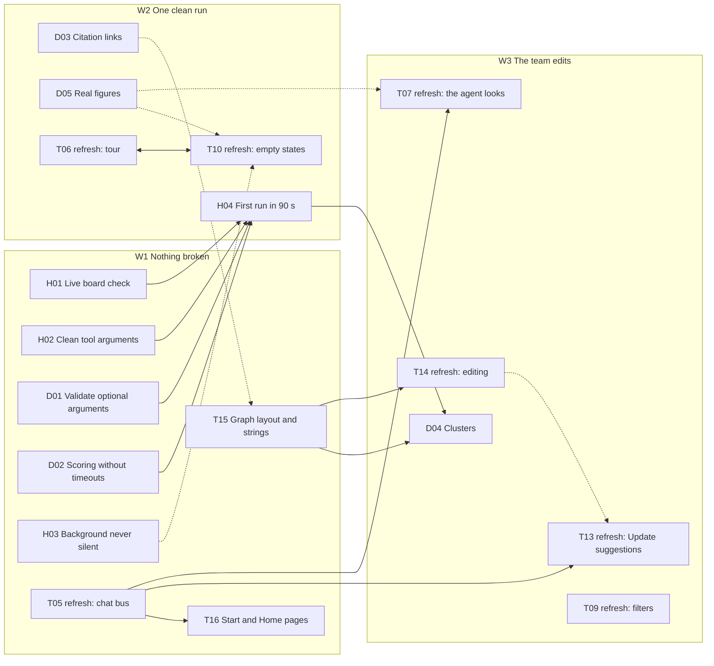

# Work packages

Work packages (WPs) split the design in [`docs/Concept.md`](../Concept.md) and [`docs/architecture.html`](../architecture.html) into pieces one person can pick up, build and check off. Each group of WPs has its own folder.

| Group | Folder | What it covers | Status |
| --- | --- | --- | --- |
| tldraw integration (T) | [`tldraw-integration/`](tldraw-integration/README.md) | The tldraw board and its custom shapes, the board service (sync rooms, canvas MCP and layout, ACP pipe, REST + SSE), the chat panel, the board UI (cards, paper widgets, ranked list, filters, top bar and toolbar, link and note editing), the Start and Home pages, external agents, and the board-facing half of the harness (ACP adapter, canvas and viewer tools). Includes the interfaces with the harness and discovery owners. Model: Nemotron 3.5 Super VL on Token Factory. | Mostly built; refreshed Oct 20 (T15 and T16 added) |
| Agent harness (H) | [`agent-harness/`](agent-harness/README.md) | The agents (master, search, reader, context), the background passes that fill in the cards, the code that ranks per goal and links papers without the model, and the live board check. | Planned Oct 20 |
| Discovery (D) | [`discovery/`](discovery/README.md) | The papers MCP: argument validation, scoring robustness, citation links, clusters and figures with images. | Planned Oct 20 |

## How a WP is written

Every WP file follows the same outline, so they can be read side by side:

1. **Header table:** lane, size, dependencies, milestone, status and owner; WPs in the finish plan also give a priority (P0 to P2).
2. **Goal:** one paragraph on what is true when the WP is done.
3. **Context:** the diagram or section of the design it implements.
4. **Scope:** what is in and what is explicitly out.
5. **Design:** the contracts and choices someone needs to build it without asking.
6. **Tasks:** a checklist with the files each task touches.
7. **Acceptance criteria:** checks a reviewer can run.
8. **Tests, risks and references.**

Sizes are relative: **S** is a focused session, **M** is most of a day for one person, **L** needs splitting or two people. A WP is done when every acceptance criterion holds on a clean checkout and the README of the code it touches says how to run it.

A WP refreshed by the finish plan keeps its original sections and gains two near the top: **Where it stands (Oct 20)**, what's built and where, and **What's left (v6)**, the tasks and acceptance criteria still open, against the v6 design.

## Finish plan (Oct 20)

On Oct 19 we pulled `main` (`9ba8985`), ran every test suite (all green: client 148, harness 52, discovery 36) and ran the `master` agent live on a real board. The tests miss what the live run showed: overlapping cards, searches that return nothing, cards left half-filled, a run that takes ten minutes, and most of the demo script working only on the static demo board. This plan turns those findings into work packages, in three waves.

### Waves

| Wave | Goal | WPs |
| --- | --- | --- |
| **W1 Nothing broken** | Every P0 and P1 bug fixed; the live check passes, timing aside | [H01](agent-harness/H01-live-board-check.md) live board check · [H02](agent-harness/H02-clean-tool-arguments.md) clean tool arguments · [D01](discovery/D01-validate-optional-arguments.md) validate optional arguments · [D02](discovery/D02-scoring-without-timeouts.md) scoring without timeouts · [H03](agent-harness/H03-background-never-silent.md) background never silent · [T15](tldraw-integration/T15-graph-layout-and-strings.md) graph layout and strings · [T16](tldraw-integration/T16-start-and-home-pages.md) Start and Home pages · [T05 refresh](tldraw-integration/T05-chat-panel.md) chat bus |
| **W2 One clean run** | Demo-script steps 1 to 6 on a real board: first cards within 90 s, the answer within 2 minutes, every card filled within 5 minutes, with evidence a judge can click | [H04](agent-harness/H04-first-run-in-90-seconds.md) first run in 90 s · [D03](discovery/D03-citation-links.md) citation links · [D05](discovery/D05-real-figures.md) real figures · [T06 refresh](tldraw-integration/T06-viewer-actions.md) the tour · [T10 refresh](tldraw-integration/T10-paper-card.md) widget empty states |
| **W3 The team edits** | Demo-script step 7 (clusters, links and notes, Update suggestions), plus filters and the agent looking at the board | [D04](discovery/D04-clusters-from-data.md) clusters · [T13 refresh](tldraw-integration/T13-board-chrome.md) Update suggestions · [T14 refresh](tldraw-integration/T14-board-editing.md) link and note editing · [T09 refresh](tldraw-integration/T09-ranked-list.md) filters · [T07 refresh](tldraw-integration/T07-board-context.md) the agent looks |

Within a wave, WPs in different groups run in parallel; owners are TBD.

Solid arrows are hard dependencies; dotted ones mean the later WP shows the earlier one's work but can be built first.

**The gate.** H01 runs the real stack on the five demo seeds and checks the room: no overlapping cards, every card filled in or saying why not, no placeholder arguments, no HTTP 400 skips, and, in strict mode, the timing targets. Every bug WP lists an H01 check in its acceptance criteria, and H04 passes when H01's strict mode passes twice in a row.

**Fixes that exist but aren't merged.** Igor's local branch `feat/name-pinned` (not pushed) has a first version of T15's layout (`4c11405`, its layout tests not yet updated) and of T16's Start flow (`95358a0`, whose landing `Authorization` part is already on `main` as `552eda7`). T15 and T16 describe the changes in full, so nobody depends on that branch. The local `feat/pitch-video` branch has uncommitted edits to `discovery/` and `harness/` that duplicate what's on `main`; drop them before merging `main` into it.

### Traceability: findings to work packages

Each finding from the Oct 19 review, with its evidence and the WP whose acceptance criteria catch it.

| # | Finding | Evidence | WP |
| --- | --- | --- | --- |
| F1 | The search agent's model (Lightning) sends "None" as text for optional arguments, and the papers MCP accepts it | `since="None"`: PubMed returns 0 hits with no error, OpenAlex and Tavily answer HTTP 400, `_pubmed_links` crashes on `int('None')`, `citing` answers 400; one sub-query got no keyword results and one search agent made over a dozen calls | [H02](agent-harness/H02-clean-tool-arguments.md), [D01](discovery/D01-validate-optional-arguments.md), checked by [H01](agent-harness/H01-live-board-check.md) |
| F2 | `score_candidates` times out with a bare "Error executing tool" | An embedding batch of 64 took over 60 s; the master retried | [D02](discovery/D02-scoring-without-timeouts.md) |
| F3 | The context agent fails silently | 3 of 16 cards: a summary but no "Why it matters", no glance, no gap, badge off | [H03](agent-harness/H03-background-never-silent.md), shown by the [T10 refresh](tldraw-integration/T10-paper-card.md) |
| F4 | A first run is slow and places extra papers | First cards after about 2 minutes, answer at 180 s, last card filled after about 9 m 45 s; `rerank` read 100 abstracts, so 16 suggestions instead of 12; 16 `set_scores` calls written by the model | [H04](agent-harness/H04-first-run-in-90-seconds.md) |
| F5 | The chat answer is messy | Narration between tool calls; whitespace-only chunks start new message items (`chatState.ts`) | [H04](agent-harness/H04-first-run-in-90-seconds.md) (instruction), [T05 refresh](tldraw-integration/T05-chat-panel.md) |
| F6 | Cards overlap | The layout places 48 × 48 nodes but the browser draws 172 × 70 cards: 17 of 153 pairs overlap, the two seeds overlap, 18 cards in 450 × 350 px | [T15](tldraw-integration/T15-graph-layout-and-strings.md), checked by H01 |
| F7 | Cluster frame cells are narrower than a card | `CELL = {w: 150, h: 130}` in `clusterTools.ts` | [T15](tldraw-integration/T15-graph-layout-and-strings.md) |
| F8 | "cites N of your seeds" is false, and no tool makes `cites` links | 38 links, all `similar`; `card.ts` counts any link | [D03](discovery/D03-citation-links.md), [T15](tldraw-integration/T15-graph-layout-and-strings.md) |
| F9 | Node growth by links is invisible | `resizeByLinks` changes `w`/`h`; the card is always 172 × 70 | [T15](tldraw-integration/T15-graph-layout-and-strings.md) |
| F10 | No clusters on a real board | The papers MCP has no `cluster_papers` | [D04](discovery/D04-clusters-from-data.md) |
| F11 | The Start page fails without `?mock=1` | `POST /boards/:id/runs` answers 404 (reproduced); pressing ↑ again makes a second board | [T16](tldraw-integration/T16-start-and-home-pages.md) |
| F12 | PDF seeds fail | `postSeed` takes only JSON `{doi}` or `{pmid}` | [T16](tldraw-integration/T16-start-and-home-pages.md) |
| F13 | Home has no counts; `/` opens a random room; the browser never posts `/seen` | `boardView` lacks `paperCount` and `newCount`; `Root.tsx` | [T16](tldraw-integration/T16-start-and-home-pages.md) |
| F14 | No Catch-me-up tour | No tour bar, `?tour=1` ignored, `_canvas/tour` only logged | [T06 refresh](tldraw-integration/T06-viewer-actions.md) |
| F15 | Keep doesn't move on; Discard just closes | `ActionsWidget` in `parts.tsx` | [T06 refresh](tldraw-integration/T06-viewer-actions.md), [T10 refresh](tldraw-integration/T10-paper-card.md) |
| F16 | A note placed on a paper doesn't pin to it | No side effect; pinning works only from a widget | [T14 refresh](tldraw-integration/T14-board-editing.md) |
| F17 | No "Update suggestions" or "See what it did" | Only on `demo-board.html` | [T13 refresh](tldraw-integration/T13-board-chrome.md) |
| F18 | "Find more like this" does nothing | It dispatches `pdc:ask` and nobody listens | [T05 refresh](tldraw-integration/T05-chat-panel.md), [T10 refresh](tldraw-integration/T10-paper-card.md) |
| F19 | No figures on real cards | `get_fulltext` has no image URL; PMC's article page maps `<figure id>` to its CDN image | [D05](discovery/D05-real-figures.md) |
| F20 | Seeds and failed cards spin forever | Glance and figure widgets show "Reading…" whenever they're empty | [T10 refresh](tldraw-integration/T10-paper-card.md) |
| F21 | No filters UI, and no citation counts to filter by | The `filters` atom has no UI; discovery emits no `citedBy` | [T09 refresh](tldraw-integration/T09-ranked-list.md) |
| F22 | The agent can't look at the board | `_canvas/snapshot` answers "not supported yet" | [T07 refresh](tldraw-integration/T07-board-context.md) |
| F23 | The top bar shows the room ID, not the board's title | `TopBar.tsx` | [T13 refresh](tldraw-integration/T13-board-chrome.md) |
| F24 | The master's reader is one shared `AgentTool` | Parallel reads would share one MCP session | [H03](agent-harness/H03-background-never-silent.md) |
| F25 | WP statuses on `main` were stale | T03, T04, T05, T09, T10 and T13 said "Not started" | Fixed by this plan: statuses refreshed in [tldraw integration](tldraw-integration/README.md#where-it-stands-on-oct-20) |

### Out of scope for the finish plan

- Deploying: a Docker image with the harness and the papers MCP (today's `client/Dockerfile` has the board service only), and running on Nebius.
- [T11](tldraw-integration/T11-external-agents.md) personal tokens for external agents.
- The PDF reader with shared highlights, and "highlight a passage, it becomes a node" ([T10](tldraw-integration/T10-paper-card.md)'s Phase B).
- [T06](tldraw-integration/T06-viewer-actions.md)'s "Follow the agent" switch and busy-user queue.
- [T12](tldraw-integration/T12-integration-demo.md)'s keyless end-to-end test, Docker smoke test and memory measurement.
- Verdicts, citation overlap and recency in `score_candidates`, and early placement on verdicts (Concept's steps 5 and 7).
