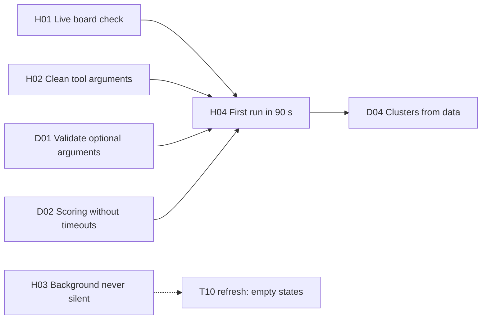

# Agent harness: the agents, their background passes and the live check

Oct 20, 2026 · Work package group H · Status: planned (finish plan, see the [top-level README](../README.md#finish-plan-oct-20))

This group finishes the agents in `harness/`: the `master` on a board, the `search`, `reader` and `context` agents it runs, the background passes that fill in the cards, and the glue that keeps paper IDs out of the model's hands. It also owns the live check that every bug and performance WP uses as its gate. The board-facing half of the harness (the ACP adapter, the canvas and viewer tools, snapshots) stays in [tldraw integration](../tldraw-integration/README.md) (T04, T06, T07); the papers MCP is the [discovery group](../discovery/README.md).

## Where it stands on Oct 20

`main` at `9ba8985`. The offline tests are green (`uv run pytest` in `harness/`: 52 passed). One live run of `master` on a real board with two seeds (board `b_ngbwycazag`, Oct 19) showed:

| What | Measured | Finding |
| --- | --- | --- |
| First cards on the board | about 2 minutes after the prompt | F4 |
| The answer in the chat | 180 s | F4 |
| Every card filled in | about 9 minutes 45 seconds | F4 |
| Papers placed | 16 suggestions instead of 12: `rerank` read the top 100 and the master placed 4 more | F4 |
| `set_scores` | 16 calls written by the model, one per paper | F4 |
| Search arguments | Lightning sent `since: "None"`, `sources: "None"`, `exclude_ids: "None"`; one search agent made over a dozen calls instead of 3 or fewer | F1 |
| Context pass | 3 of 16 cards ended with a summary but no "Why it matters" and no glance, no gap note, badge off | F3 |
| Chat answer | Narration between tool calls ("The scoring call errored; let me retry it once.") and runs of blank lines | F5 |

The finding numbers (F1 to F25) are listed with their evidence in the [top-level README](../README.md#traceability-findings-to-work-packages).

## The work packages

| WP | Title | Lane | Size | Priority | Depends on | Milestone |
| --- | --- | --- | --- | --- | --- | --- |
| [H01](H01-live-board-check.md) | Live board check | Harness + Board | M | P0 | — | W1 Nothing broken |
| [H02](H02-clean-tool-arguments.md) | Clean the tool arguments the model writes as text | Harness | S | P0 | — | W1 Nothing broken |
| [H03](H03-background-never-silent.md) | Background passes never fail silently | Harness | M | P1 | — | W1 Nothing broken |
| [H04](H04-first-run-in-90-seconds.md) | A first run in 90 seconds | Harness | M | P1 | H01, H02, [D01](../discovery/D01-validate-optional-arguments.md), [D02](../discovery/D02-scoring-without-timeouts.md) | W2 One clean run |



**Suggested order:** H01 first, so every later fix is measured against the same run; H02 and H03 in parallel with the discovery group's D01 and D02; H04 once those are in, because the timings only mean something after the bugs are gone.

## Shared contracts

Fixed here so the groups can build against each other. A WP that changes one updates this section in the same pull request.

**After-placement steps.** Once the master has placed papers, four steps follow, three of them model-free (the reading runs the reader and context agents). They run in `ProcessPapers` (`harness/harness/agents/master/background.py`) in this order, each through a `Step` so its writes carry the turn's run ID and the researcher's bearer:

| Order | Step | When | WP | Writes |
| --- | --- | --- | --- | --- |
| 1 | Citation links among the board's papers | When reading starts (`process_papers`, or `after_turn` if the master never called it) | [D03](../discovery/D03-citation-links.md) | `link_papers` kind `cites`, from `citation_links` |
| 2 | Near links: each placed suggestion to its `near` | Right after step 1 | [T15](../tldraw-integration/T15-graph-layout-and-strings.md) | `link_papers` kind `similar` |
| 3 | Reading: reader, card writes, context agent, badge off | Right after step 2, in the background, 4 papers at a time | exists; H03 makes failures visible | `add_quote`, `set_card`, `link_papers`, `mark_working` |
| 4 | Clusters, once per board | At the end of the master's turn (`after_turn`), after `rank_papers` | [D04](../discovery/D04-clusters-from-data.md) | `apply_clusters` |

The canvas skips a `similar` link when a `cites` link already joins the pair (T15), so the order means citations win. A step that fails logs a warning and the next one still runs.

**`rank_papers`** ([H04](H04-first-run-in-90-seconds.md)). A function tool on the master with no arguments the model fills in:

| Part | Rule |
| --- | --- |
| Papers | The suggestions the master placed in this conversation (`candidates.placed`), without seeds and discarded papers; only placed papers are written, so unplaced candidates aren't ranked (Oct 21: ranking 20 instead of 8 made `rank_papers` take 34 to 52 s) |
| Goals | The board's goals from the last `get_board`; one `rerank` per goal, in parallel |
| Goal text | The researcher's question (`candidates.QUESTION`) plus the goal's description: `new-findings` "new results on the question", `methods` "methods the researcher could reuse"; any other goal ID uses its label |
| Writes | `set_scores` for every placed suggestion and every goal: fit `high` when the rerank score is 0.7 or more, `medium` from 0.4, else `low`; papers the rerank left out get score 0.2, fit `low`, why "Not in the agent's top picks for this goal" |
| Returns | `{goals: {<goalId>: [{paperId, title, year, reason}]}, scored, skipped}` for the master's answer |
| Places | Nothing: no second `add_papers` |

**Argument cleaning** ([H02](H02-clean-tool-arguments.md)). Before any MCP tool call, an argument is dropped when it is not in the tool's `inputSchema.required` and its value is one of `"None"`, `"none"`, `"null"`, `"NULL"`, `"undefined"` or `""`. Required arguments and empty lists are never touched (`candidates.fill` relies on `paper_ids: []`).

**Gaps the background writes** (on the card's `gaps`, shown by the widgets, [T10](../tldraw-integration/T10-paper-card.md)):

| Case | Text |
| --- | --- |
| Abstract only | "Read from the abstract only: no full text was available." (exists) |
| Reader failed | "The agent couldn't read this paper: <reason>" (exists) |
| Context wrote no `oneLine` after a retry | "The agent couldn't write why this paper matters: <reason>" (H03) |
| Context wrote no `glance` | "The agent couldn't draw the paper at a glance." (H03) |
| Chat closed mid-read | "The agent stopped reading this paper: the chat closed first." (exists) |

**Timing targets** (H04, checked by H01 with `LIVE_TIMING=strict`), measured from the prompt on a cold discovery cache with the five demo seeds:

| Moment | Target | Oct 19 |
| --- | --- | --- |
| First card on the board | 90 s or less | about 120 s |
| The answer in the chat (`end_turn`) | 120 s or less | 180 s |
| Every card's badge off | 300 s or less | about 585 s |

**Live report** (H01): `harness/tests/live/reports/<UTC time>.json`, gitignored:

```json
{
  "board": "b_…", "seeds": 5, "warm": false, "model": "nvidia/Nemotron-3.5-Super-VL",
  "timings": {"tFirstCard": 0.0, "tAnswer": 0.0, "tFilled": 0.0},
  "counts": {"suggestions": 0, "overlaps": 0, "missingWhy": 0, "gapsOnly": 0,
             "citesLinks": 0, "similarLinks": 0, "clusters": 0,
             "placeholderArgs": 0, "placeholderArgsWritten": 0, "http400Skips": 0, "modelCalls": 0},
  "costUsd": 0.0
}
```

## Acceptance criteria for the group

1. `uv run pytest` in `harness/` passes with no API keys, including the new scripted tests of H02, H03 and H04.
2. `uv run pytest -m live -k master_board` (H01) passes on a clean checkout with keys, on the five demo seeds: no overlapping cards, every suggestion with "Why it matters" or a gap, no placeholder arguments, no HTTP 400 skips.
3. The same run with `LIVE_TIMING=strict` passes twice in a row.
4. `harness/README.md` says how to run the live check and lists the after-placement steps.

## Out of scope

- The ACP adapter, viewer tools and snapshots (T04, T06, T07 in tldraw integration).
- The papers MCP's tools themselves (discovery group); this group only calls them.
- Verdicts per candidate and early placement before scoring (Concept's step 7); the relaxed targets don't need them.
- Model providers other than Token Factory.

## Decisions

| # | Decision | Why |
| --- | --- | --- |
| DH1 | Per-goal fit is written by code (`rank_papers`), not by the model | The model wrote 16 `set_scores` calls and guessed the `methods` fit from one rerank for the question; one `rerank` per goal gives each goal a real ranking, and the scores reach the board without a model retyping them |
| DH2 | `PLACE = 8` suggestions in a first run (was 12) | Eight cards read four at a time fit the 5-minute target; a teammate's branch `worktree-place-two-papers` tried 2, too few for a board |
| DH3 | The context agent stays on Lightning unless H01 shows more than 1 card in 8 needing H03's fallback; then it moves to Super VL | Lightning is cheaper and faster, but 3 of 16 cards failed on Oct 19; the decision is made on measured numbers, recorded in H03 |
| DH4 | The live gate runs on a cold discovery cache | A judge's first run is cold; warm numbers are recorded too |

## Risks

| Risk | Effect | Mitigation | WP |
| --- | --- | --- | --- |
| Token Factory's limit (60 requests a minute to start), shared by the chat, the background and the papers MCP | 429s mid-run | `CALLS_PER_MINUTE` for the background, LiteLLM `num_retries` retrying with backoff (it doesn't read `Retry-After`) | H04 |
| Live timings vary run to run | A flaky gate | Timing asserted only in strict mode, twice in a row; everything else always asserted | H01 |
| Model-free steps hide what happened from the chat | Less trace for judges | Every step logs, and `rank_papers` returns its rankings for the answer; tool cards for background passes stay out of scope | H03, H04 |

## Open questions

- [ ] Should the background passes get tool cards in the chat after the turn (a "Reading" section), so judges see them? Not in this plan.
- [ ] Does `PLACE = 8` look full enough on the board, or does the demo want 10? Decide after the first strict H01 run.
