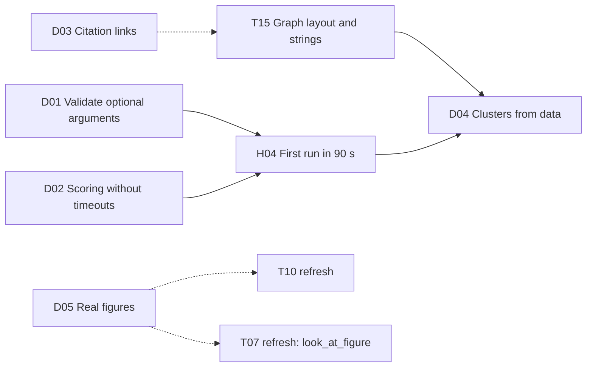

# Discovery: the papers MCP

Oct 20, 2026 · Work package group D · Status: planned (finish plan, see the [top-level README](../README.md#finish-plan-oct-20))

This group finishes the papers MCP in `discovery/`: the tools every agent and the board service call to search, score, rank, read and check papers. It fixes the bugs the Oct 19 live run found and adds the three tools the board still waits for: citation links, figures with images, and clusters. Each WP that adds a tool also wires it into the harness or the board, so the feature is visible when the WP is done. How the agents use the tools is the [agent harness group](../agent-harness/README.md); the board side is [tldraw integration](../tldraw-integration/README.md).

## Where it stands on Oct 20

`main` at `9ba8985`. `uv run pytest` in `discovery/` passes (36 tests). The tools `search`, `find_candidates`, `score_candidates`, `rerank`, `resolve_seed`, `get_paper`, `get_fulltext` and `check_quotes` exist ([discovery README](../../../discovery/README.md)).

| Finding | What the Oct 19 run showed | WP |
| --- | --- | --- |
| F1 | `since: "None"` passed validation: PubMed returned 0 hits with no error, OpenAlex and Tavily answered HTTP 400 (`from_publication_date:None`), `_pubmed_links` crashed on `int('None')`, `citing` answered 400 | D01 |
| F2 | `score_candidates` failed once with "Error executing tool score_candidates": an embedding batch of 64 timed out after 60 s; the master retried | D02 |
| F8 | No tool says which board papers cite each other, so the board has no `cites` links; the card's "cites N of your seeds" counts `similar` links | D03 |
| F10 | No `cluster_papers`, so the canvas MCP never lists `apply_clusters`: no clusters on a real board | D04 |
| F19 | `get_fulltext` lists PMC figures by label and caption, with no image URL, so no figure reaches a card | D05 |

## The work packages

| WP | Title | Lane | Size | Priority | Depends on | Milestone |
| --- | --- | --- | --- | --- | --- | --- |
| [D01](D01-validate-optional-arguments.md) | Validate optional tool arguments | Discovery | S | P0 | — | W1 Nothing broken |
| [D02](D02-scoring-without-timeouts.md) | Scoring without timeouts | Discovery | S | P1 | — | W1 Nothing broken |
| [D03](D03-citation-links.md) | Citation links between board papers | Discovery + Harness + Board | M | P1 | — ([T15](../tldraw-integration/T15-graph-layout-and-strings.md) for the card note) | W2 One clean run |
| [D04](D04-clusters-from-data.md) | Clusters from data | Discovery + Harness | M | P2 | T15, [H04](../agent-harness/H04-first-run-in-90-seconds.md) | W3 The team edits |
| [D05](D05-real-figures.md) | Real figures on the card | Discovery + Harness | M | P1 | — ([T10 refresh](../tldraw-integration/T10-paper-card.md) for the empty state) | W2 One clean run |

**Suggested order:** D01 and D02 first (small, and they unblock H04's timing); D03 and D05 in parallel for the demo run; D04 last, once the layout (T15) fits cards in frames and the first run is fast enough to add a clustering step.

## Shared contracts

Fixed here so the groups can build against each other; [interfaces.md I5](../tldraw-integration/interfaces.md#i5-what-the-board-service-needs-from-the-papers-mcp) lists the same tools from the board's side. A WP that changes one updates both in the same pull request.

**New and changed tools:**

| Tool | Input | Output | WP |
| --- | --- | --- | --- |
| `search`, `find_candidates` | `since`: `YYYY`, `YYYY-MM` or `YYYY-MM-DD`; a placeholder string ("None", "null", "") counts as not given; list arguments the same | Unchanged | D01 |
| `score_candidates` | Unchanged | Unchanged, plus `skipped` names candidates that couldn't be embedded; a readable tool error only when nothing could be | D02 |
| `citation_links` (new) | `paper_ids` (2 to 200) | `{links: [{from, to, source: "pubmed" \| "openalex"}], skipped}`; `from` cites `to`, both in `paper_ids`, under the IDs given | D03 |
| `cluster_papers` (new) | `paper_ids` (2 to 500), `k` (optional) | `{clusters: [{clusterId, paperIds, label \| null}], similarities: [{a, b, similarity}]}` as I5 already defines; `clusterId` is stable for the same core paper | D04 |
| `get_figures` (new) | `paper_id` | `{paperId, source, figures: [{figureId, label, caption, imageUrl \| null}], skipped}` | D05 |
| `get_fulltext` | Unchanged | `figures[]` gain `imageUrl` | D05 |

**Placeholders** are the same list the harness drops ([H02](../agent-harness/H02-clean-tool-arguments.md)): `"None"`, `"none"`, `"null"`, `"NULL"`, `"undefined"`, `""`.

**Embedding constants** (D02): `BATCH = 32` texts per request, `EMBED_CONCURRENCY = 4` requests at once, 90 s timeout, 2 retries (2 s, then 5 s, or `Retry-After`) on timeouts, 429 and 5xx.

**New environment variables:**

| Variable | WP | Default | Meaning |
| --- | --- | --- | --- |
| `EMBED_CONCURRENCY` | D02 | `4` | Embedding requests in flight at once |
| `LIGHTNING_MODEL` | D04 | `nvidia/Nemotron-3_5-Lightning` | Already read by the harness; the papers MCP uses it to name clusters |

## Acceptance criteria for the group

1. `uv run pytest` in `discovery/` passes with no API keys, including the new tests of D01 to D05 (fixtures for PubMed `elink`, a PMC article page and clustering).
2. An MCP client (the MCP Inspector or `harness.check`) lists `citation_links`, `cluster_papers` and `get_figures`, and `search(query, since="None")` returns papers from PubMed, OpenAlex and the web.
3. [H01](../agent-harness/H01-live-board-check.md) on the five demo seeds shows cites links, 2 to 6 clusters and at least one card with a real figure, with no HTTP 400 skips.
4. `discovery/README.md` documents the new tools, the validation rules and the embedding settings.

## Out of scope

- Verdicts per candidate, citation overlap and recency in `score_candidates` (Concept's step 5); scoring stays embedding similarity.
- Parse or any PDF parsing for full text; figures come from PMC only.
- Looking at figure images with Super VL to pick them (the reader picks by caption); [T07](../tldraw-integration/T07-board-context.md)'s `look_at_figure` lets the chat agent look on request.

## Decisions

| # | Decision | Why |
| --- | --- | --- |
| DD1 | Clusters by k-means++ on the stored embeddings, in numpy, with no new dependency | The vectors exist (LanceDB, `paper_vectors`); boards hold tens of papers, so numpy is fast enough; scikit-learn would add a large dependency for one call |
| DD2 | A cluster's ID comes from its medoid paper (`c-<slug of the most central paper's ID>`) | `apply_clusters` reuses frames by `clusterId`; IDs from the medoid stay the same when a paper is added, so a second run fills the existing frames instead of making new ones |
| DD3 | Figure images come from the PMC article page (`<figure id>` → `` on `cdn.ncbi.nlm.nih.gov`) | PMC's JATS XML names the image file but not its CDN path, which has hash folders; the article page has the full URL (checked on PMC4944528, Oct 20) |
| DD4 | Lightning names clusters, one call per cluster in parallel | Concept's design; short JSON answers are what Lightning is good at; a failed name leaves the frame unnamed for `label_cluster` |
| DD5 | Citation links come from PubMed first (`pubmed_pubmed_refs`), OpenAlex `referenced_works` for papers without a PMID | PubMed's links are the "fact" the board's red strings promise ([mockups: three kinds of link](../../mockups/README.md)); OpenAlex fills the gaps without a second source of truth for PubMed papers |

## Risks

| Risk | Effect | Mitigation | WP |
| --- | --- | --- | --- |
| PMC answers with a small block page instead of the article | No figure | Retry twice, 2 s apart; cache what worked; the widget shows "No free figure" instead of waiting (T10 refresh) | D05 |
| PMC changes its page markup | No figure | The parser is one function with a fixture test; a failing parse logs and hides the figure, never breaks a read | D05 |
| OpenAlex's budget (keyless use shares a tiny per-IP budget) | Missing `citing` candidates and OpenAlex citation links | `OPENALEX_API_KEY` is in SecretStash; PubMed covers most demo papers | D03 |
| NCBI's 3 requests a second without a key | Slow `elink` for 200 papers | `NCBI_API_KEY` raises it to 10; `elink` takes many PMIDs per request | D03 |
| Clusters that make no sense to a researcher | The board looks arbitrary | Labels from member titles; people can rename, move or ungroup (T14 refresh), and the agent never undoes it | D04 |

## Open questions

- [ ] Should `cluster_papers` blend citation overlap into similarity (Concept: 0.6 × cosine + 0.4 × citation overlap) once D03 exists? D04 lists it as a stretch task.
- [ ] Should `score_candidates` add a citation-overlap term using `citation_links` to the seeds? Not planned; it would change rankings the demo has been rehearsed with.
