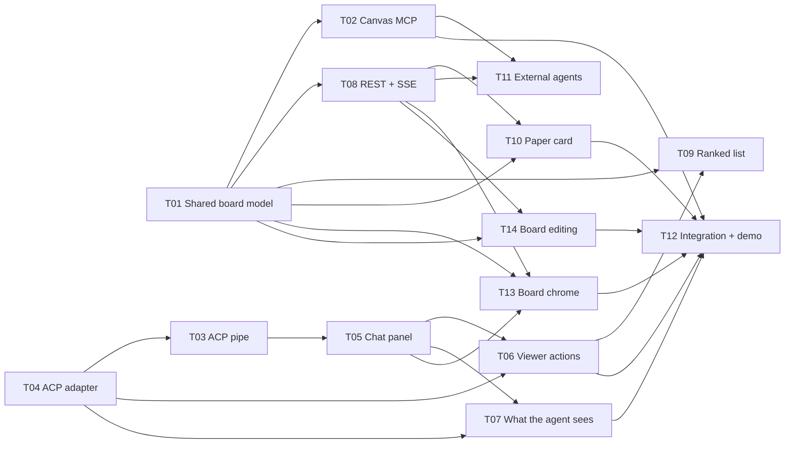
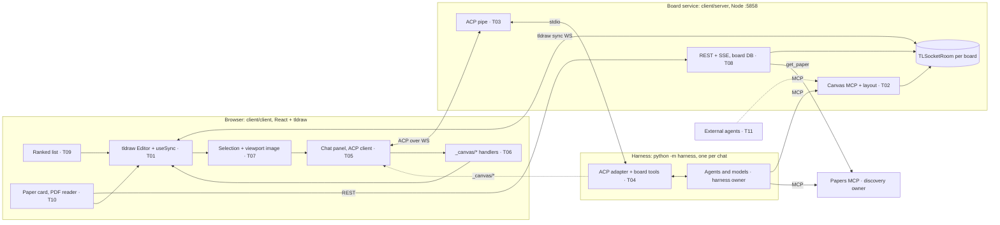
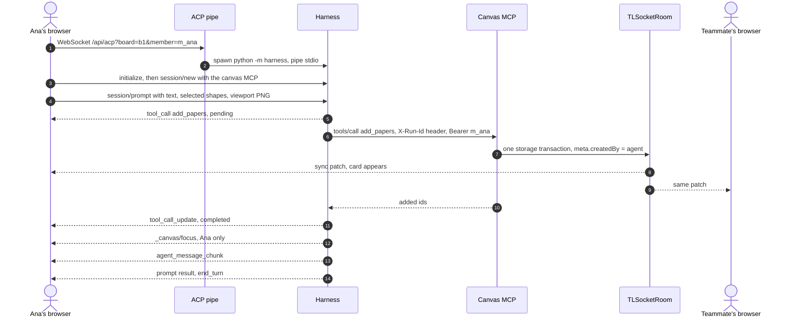

# tldraw integration: the board, the board service and the agent's way in

Oct 18, 2026 · Work package group T · Branch `feat/tldraw-agent-integration` · Status: planned

This group builds everything between a researcher's browser and the agents: the tldraw board and its custom shapes, the board service that owns each shared room, the chat panel that talks ACP over a WebSocket, the canvas MCP that agents write through, the REST and SSE API, the v4 board UI (nodes, paper card, ranked list, filters, top and bottom bars, link and note editing), and the half of the harness that faces the board (the ACP adapter and the canvas and viewer tools). The agents' reasoning, their models and the discovery service belong to other owners; this group meets them at the contracts in [`interfaces.md`](interfaces.md).

## Scope at a glance

The circled part of [architecture diagram 1](../../architecture.html#components) is ours, plus the board-facing half of the agent harness.

| Part (diagram 1) | Owner | WPs |
| --- | --- | --- |
| Browser: canvas (tldraw + `useSync`) | **This group** | T01, T06, T07 |
| Browser: chat panel (ACP client) | **This group** | T05, T06, T07 |
| Browser: ranked list + paper card (v4), filters, top and bottom bars, editing | **This group** | T09, T10, T13, T14 |
| Board service: sync rooms | **This group** (exists, extended) | T01, T02 |
| Board service: canvas MCP + layout service | **This group** | T02, T11 |
| Board service: ACP pipe | **This group** | T03 |
| Board service: REST + SSE API | **This group** | T08 |
| Agent harness: ACP adapter, canvas and viewer tools, prompt mapping | **This group** | T04, T06, T07 |
| Agent harness: agents (master, search, reader, context), models | Harness owner | [`interfaces.md`](interfaces.md) |
| Discovery service: papers MCP, pipeline, store | Discovery owner | [`interfaces.md`](interfaces.md) |
| External agents (Claude, Cursor) on the canvas MCP | **This group** (connection only) | T11 |

## Where we start

| Piece | State on Oct 18 | Where |
| --- | --- | --- |
| tldraw board | Multiplayer starter ported to a Node sync server: one `TLSocketRoom` per room, one SQLite file per room, `POST /api/rooms/:room/shapes` writes validated shapes server-side; default shapes only | `client/server/server.ts`, `client/client/pages/Room.tsx` |
| Harness | ADK 2.12 with Nemotron on Token Factory via LiteLLM; `search` agent; `toolsets.papers()`, `toolsets.canvas()`, `toolsets.tavily()`; offline tests with a scripted model | `harness/` |
| Papers MCP | `search`, `find_candidates`, `resolve_seed`, `get_paper` over streamable HTTP on `:8001` | `discovery/` |
| ACP adapter, chat panel, canvas MCP, REST API, ranked list, paper card | Not built | — |
| Visual design | v4 clickable mockup of the whole board with real papers | `docs/mockups/flashcard-v4.html`, [mockups README](../../mockups/README.md) |

## The model: Nemotron 3.5 Super VL on Token Factory

Every board-facing agent in this group, and every live agent test, runs on **Nemotron 3.5 Super VL** (`nvidia/Nemotron-3.5-Super-VL`) on Nebius Token Factory. There is no other provider. Super VL matters here because it can *see*: it reads the board from a picture as well as from `get_board`'s JSON, and it reads papers' figures, drawings and charts, not just their text.

Checked on Oct 18 against the [Token Factory docs](https://docs.tokenfactory.nebius.com/api-reference/introduction) and with live calls through the harness's own path (ADK `LiteLlm` to Token Factory, key from `TF_API_KEY`):

| Fact | Evidence |
| --- | --- |
| OpenAI-compatible API at `https://api.tokenfactory.nebius.com/v1/` (chat completions, models, tools); the harness reaches it through LiteLLM's `openai/` provider | [API introduction](https://docs.tokenfactory.nebius.com/api-reference/introduction); `harness/harness/models.py` |
| `nvidia/Nemotron-3.5-Super-VL` and `nvidia/Nemotron-3_5-Lightning` are served (28 models in the catalogue) | `uv run python -m harness.check` |
| Super VL calls tools through ADK | `harness.check`: "Super VL tool call: ok" |
| Images go in as OpenAI `image_url` parts, by URL or base64; ADK sends a `Part(inline_data=…)` as base64 for us | [Vision capabilities](https://docs.tokenfactory.nebius.com/api-reference/examples/vision-capabilities); a probe sent `docs/mockups/shots/canvas.png` and Super VL listed the cards (Tirosh 2016, Sade-Feldman 2018, Lindqvist 2024, …), the clusters and the legend; sent `card-full.png`, it described the figure's UMAP and tissue-section panels |
| Images are cheap in tokens: the 275 KB board screenshot cost about 1,400 prompt tokens, the 487 KB card about 3,300 | Usage metadata from the probe |
| Super VL reasons by default and returns the reasoning separately as `reasoning_content`; ADK turns it into thought parts (also when streaming), so the chat can show it dimmed and keep it out of the answer | Raw API call and an ADK streaming probe |
| `chat_template_kwargs: {"enable_thinking": false}` turns reasoning off for one call | Raw API call |
| Tool results go back as `role: "tool"` messages with text content, so an image a tool fetches must reach the model in a separate user message (see T07) | [Function calling](https://docs.tokenfactory.nebius.com/ai-models-inference/function-calling) |
| Rate limits start at 60 requests and 400,000 tokens a minute, scale up dynamically, and return HTTP 429 with `Retry-After` | [Rate limits](https://docs.tokenfactory.nebius.com/ai-models-inference/rate-limits) |

Two things the probes showed that matter to the harness owner are in [I8](interfaces.md#i8-token-factory-notes-for-the-harness-owner).

## The work packages

| WP | Title | Lane | Size | Depends on | Milestone |
| --- | --- | --- | --- | --- | --- |
| [T01](T01-shared-board-model.md) | Shared board model: custom shapes, IDs, attribution, human-touched flags | Board + Browser | M | — | M2 |
| [T02](T02-canvas-mcp.md) | Canvas MCP and layout service | Board | M | T01 | M2 |
| [T03](T03-acp-pipe.md) | ACP pipe: WebSocket to harness stdio | Board | S | T04 echo mode | M1 |
| [T04](T04-acp-adapter.md) | ACP adapter: `python -m harness` | Harness (board half) | M | I1 | M1 |
| [T05](T05-chat-panel.md) | Chat panel: browser ACP client | Browser | M | T03 | M1 |
| [T06](T06-viewer-actions.md) | Per-viewer canvas actions: focus, highlight, open paper, catch-up tour | Harness + Browser | S | T04, T05 | M3 |
| [T07](T07-board-context.md) | What the agent sees: selection, the board and papers as images | Browser + Harness | M | T04, T05 | M3 |
| [T08](T08-rest-sse-api.md) | REST + SSE API and board DB | Board | M | T01 | M4 |
| [T09](T09-ranked-list.md) | Ranked list, filters and "Looking for" (v4) | Browser | M | T01, T06, T08 | M4 |
| [T10](T10-paper-card.md) | Paper card (v4) and PDF reading | Browser | L | T01, T08 | M4 |
| [T11](T11-external-agents.md) | External agents on the canvas MCP | Board + Browser | S | T02, T08 | M5 |
| [T12](T12-integration-demo.md) | Integration check and demo run | All | M | T02 to T07 | M5 |
| [T13](T13-board-chrome.md) | Board chrome (v4): top bar, bottom bar, help | Browser | M | T01, T05, T08 | M4 |
| [T14](T14-board-editing.md) | Editing the board (v4): links and pinned notes | Browser | M | T01, T08 | M4 |

**Suggested order for one person:** T04 echo mode, T03, T05 (M1: chat works), then T01, T02 (M2: the agent writes to the board), then T06, T07 (M3), then T08, T13, T10, T09, T14 (M4: the v4 board), then T11, T12 (M5). With a second person, the Board lane (T01, T02, T08) and the Browser lane (T05, T13, T10, T09, T14) run in parallel from the start, meeting at the contracts below.

## Visual spec: the v4 mockup

Ralph's [v4 mockup](../../mockups/README.md) (`docs/mockups/flashcard-v4.html`, merged from `main` on Oct 18) is the visual spec for the browser side. Where it differs from Concept.md, v4 wins for the UI; where it needs data, [I9](interfaces.md#i9-discovery-data-the-v4-card-shows) lists what the agent and discovery service supply.

| v4 element | WP |
| --- | --- |
| Nodes: bookmark squares for seeds and kept papers, circles coloured by fit, NEW badge, "Agent is reading…" ring, first author and year under each node, cluster frames | T01 |
| Opening a paper zooms to it and fades everything it isn't linked to; the layered card (figure, title, one sentence with hover quotes, "Compared with your seeds", Details, Keep or Discard) | T10 |
| "Catch me up (N)" with the tour inside the card | T06, T10, T13 |
| "Looking for" (New findings or Methods to reuse) recolours and re-ranks | T09, T13 |
| Ranked list at the top left; Filter at the bottom right (fit, type, quality, year, discarded) | T09 |
| Chat at the top right; each step shows model, time and cost; asking lights papers up | T04, T05, T06 |
| Drag papers; link with the **+** handle; name, hide or delete links (cites, similar, your own) | T14 |
| Notes pinned to a paper, moving with it and shown in its card | T01, T14 |
| "N changes · the agent is waiting · Update suggestions" | T13, T07 |
| Top bar with the agent in the face pile; Note and help buttons | T13 |

v4 doesn't show the PDF reader with shared highlights from Concept's flow 5, so T10 keeps it as Phase B pending a decision (open question below).

## How the pieces fit

One prompt, end to end: Ana asks for papers, a card appears for everyone, and only Ana's view moves to it.

## Shared contracts

Fixed here so the lanes can build against each other. A WP that changes one updates this section in the same pull request.

**Board service routes.** Everything new lives under `/api`, so the Vite dev proxy in `client/vite.config.ts` forwards it with no config change.

| Route | Kind | WP | Purpose |
| --- | --- | --- | --- |
| `/api/connect/:boardId?sessionId=…` | WebSocket | exists | tldraw sync |
| `POST /api/rooms/:boardId/shapes` | HTTP | exists | Raw shape writes; T02 reuses its transaction code |
| `/api/uploads/:id`, `/api/unfurl` | HTTP | exists | Assets and bookmark previews |
| `/api/mcp/canvas/:boardId` | Streamable HTTP MCP | T02 | Every shared board change by an agent |
| `/api/acp?board=:boardId&member=:memberId` | WebSocket | T03 | One ACP connection, one harness process |
| `/api/v1/boards/…` | REST | T08 | Boards, members, papers, votes, activity, PDF proxy |
| `/api/v1/boards/:boardId/events` | SSE | T08 | Activity events as they happen |

**Identity (demo grade).** A board ID is the room ID in the URL; T08 adds a `boards` row lazily the first time a room is used. The browser makes a `memberId` (`m_` plus 10 random characters) once, keeps it in `localStorage` under `pdc.memberId`, and sends it as `member=` on the ACP socket and as `Authorization: Bearer <memberId>` on the canvas MCP and REST. The server trusts it, as the sync socket trusts anyone today. T11 adds personal tokens for external agents; tickets and real board tokens ([Concept: Protocol gotchas](../../Concept.md#protocol-gotchas)) can replace the bearer later with no tool contract change.

**Shape IDs and attribution** (helpers in `client/shared/ids.ts`, mirrored in `harness/harness/board/ids.py`; both are tested against the same fixture list).

| Item | Rule |
| --- | --- |
| Paper card ID | `shape:paper-<slug>`, where `<slug>` is the paper ID with every character outside `[A-Za-z0-9_-]` replaced by `_`: `pmid:34290406` becomes `shape:paper-pmid_34290406`. Writing the same paper twice updates one card. |
| Other agent shapes | `shape:agent-<kind>-<12 hex>`, for example `shape:agent-note-3f9a0c1d2e4b` |
| Meta on every agent write | `createdBy: "agent"`, `onBehalfOf: <memberId>`, `runId: <run_…>` (or `null`), plus `paperId` on paper-related shapes; writes from external agents also carry `via: "external"` (T11) |
| Meta on people's shapes | `author: <memberId>` (set by the browser on create) |
| Human-touched | `meta.pinnedByHuman` (moved by a person), `meta.editedByHuman` (props edited by a person); set by the browser (T01); the canvas MCP never moves or overwrites such a shape |
| Run ID | `run_` plus 12 hex characters, one per ACP prompt turn, made by the harness (T04) and sent as the `X-Run-Id` header on canvas MCP calls |

**ACP extension notifications (agent to client).** In the Python SDK, `conn.ext_notification("canvas/focus", …)` adds the leading underscore, so the method on the wire is `_canvas/focus`. All of them carry the ACP `sessionId`.

| Method | Params | Browser effect (T06) |
| --- | --- | --- |
| `_canvas/focus` | `{sessionId, shapeIds?, paperIds?, inset?, animate?}` | Zoom this viewer's camera to the union of the shapes' bounds |
| `_canvas/highlight` | `{sessionId, shapeIds?, paperIds?, durationMs?}` | Mark the shapes on this viewer's screen only; never written to the room |
| `_canvas/open_paper` | `{sessionId, paperId}` | Open the paper's card (T10) for this viewer |
| `_canvas/tour` | `{sessionId, title, steps: [{paperId, line}]}` | Run the catch-up tour inside the card (T06, T10): one step per paper, Keep or Discard moves on |

**ACP extension request (agent to client, T07).** For the agent to look at the board or a paper on its own initiative. `conn.ext_method("canvas/snapshot", …)` in the Python SDK sends `_canvas/snapshot` and waits for the browser's answer.

| Method | Params | Result |
| --- | --- | --- |
| `_canvas/snapshot` | `{sessionId, target: "viewport" \| "shapes" \| "board" \| "paper_page", shapeIds?, paperIds?, paperId?, page?, maxSide?}` | `{mimeType: "image/png", data: <base64>, width, height, caption}`, or a JSON-RPC error if the browser can't take it (hidden tab, no PDF, timeout after 10 s) |

**Prompt content (client to agent, T07).** A text block first, then one `resource` block per selected shape (`uri: tldraw://<boardId>/<shapeId>`, `mimeType: application/vnd.tldraw.shape+json`, `text`: compact shape JSON), then one `resource` block for the viewport (`uri: tldraw://<boardId>/viewport`), then `image` blocks: the viewport, and a PDF page or region when the researcher asks from the PDF reader (T10). "Update suggestions" (T13) adds a `resource` block `tldraw://<boardId>/changes` with the researcher's edits. Each image is preceded by a text line saying what it is.

**MCP servers in `session/new`.** The browser sends only the canvas MCP: `{type: "http", name: "canvas", url: <origin>/api/mcp/canvas/<boardId>, headers: [{name: "Authorization", value: "Bearer <memberId>"}]}`. The harness adds the papers MCP from `PAPERS_MCP_URL` itself (the browser has no reason to know where discovery runs), and swaps the canvas URL's origin for `BOARD_INTERNAL_URL` when that is set.

**Paper mentions in chat.** The agent writes Markdown links with a `paper:` scheme: `[Single-cell atlas of melanoma](paper:pmid:34290406)`. The chat panel renders them as buttons that run the same local focus as `_canvas/focus`.

**New environment variables** (each WP adds its own to `.env.example`).

| Variable | Read by | WP | Default | Meaning |
| --- | --- | --- | --- | --- |
| `HARNESS_CMD` | Board service | T03 | `uv run --project ../harness python -m harness` | How the board service starts one harness |
| `HARNESS_IDLE_MINUTES` | Board service | T03 | `10` | Kill a harness whose socket has been silent this long |
| `MAX_HARNESSES` | Board service | T03 | `8` | Refuse new chats above this many live harnesses |
| `BOARD_INTERNAL_URL` | Harness | T03, T04 | set by the pipe to `http://127.0.0.1:$PORT` | Origin the harness uses to reach the canvas MCP |
| `HARNESS_AGENT` | Harness | T04 | `board_assistant` | Which agent factory a chat uses (`board_assistant`, `master`, `echo`) |
| `HARNESS_MODEL` | Harness | T04, T12 | unset | `scripted:<path>` replaces every model with recorded turns, for keyless tests; unset means each agent's own Nemotron model |
| `TF_API_KEY` | Harness | exists | — | Token Factory key (the Token Factory docs call it `NEBIUS_API_KEY`; the repo's `.env.example` uses `TF_API_KEY`) |
| `PAPERS_MCP_URL` | Board service | T02, T08 | `http://127.0.0.1:8001/mcp` | Where the board service fetches paper records (already read by the harness) |
| `PUBLIC_PAPERS_MCP_URL` | Board service | T11 | unset | Papers MCP URL shown to external agents, if the discovery owner exposes it |
| `ALLOW_MEMBER_BEARER` | Board service | T11 | `1` | Set to `0` on a public deployment to accept only personal tokens on the canvas MCP |

## Milestones

| Milestone | Demo sentence | WPs |
| --- | --- | --- |
| **M1 Chat in the board** | "I type in the panel beside the board and the agent's answer streams back, with its thoughts and tool cards; Stop works." | T04, T03, T05 |
| **M2 The agent writes to the board** | "I ask for a note or a paper and it appears on every open copy of the board, attributed to the agent on my behalf, placed next to its neighbour." | T01, T02 |
| **M3 The agent sees the board** | "The agent zooms me to the cards behind its answer while my teammate's view stays put; it answers about the cards I selected, and when I ask about the layout it looks at the board itself." | T06, T07 |
| **M4 The v4 board** | "It looks like the v4 mockup. I open a paper and the board fades to what it's linked to; the card shows a real figure, hover quotes and how it compares with my seeds; I switch 'Looking for', filter by quality, pin a note, name a link, press Update suggestions, and 'Catch me up' tours the new papers inside the card. My Keep shows for everyone." | T08, T09, T10, T13, T14 |
| **M5 Open and ready** | "An external agent adds a card through the same MCP; one uncut run on Super VL; keyless and live tests are green; the Docker image runs it." | T11, T12 |

## Acceptance criteria for the group

1. With `pnpm dev` in `client/` and the papers MCP running, `http://localhost:5173/<board>` shows the canvas, a chat panel and a ranked list. A prompt streams back the answer, thoughts and one card per tool call, including tool calls made inside sub-agents.
2. A paper or note the agent adds appears in every browser open on that board within a second, placed without overlapping anything, with `meta.createdBy`, `meta.onBehalfOf` and `meta.runId` set. A card a person has moved or edited is never moved or overwritten by the agent.
3. `_canvas/focus` and `_canvas/highlight` change only the requesting browser.
4. Selected shapes and a viewport image reach the agent, and its answer is about them. Asked about the board's layout or a figure in an open paper, the agent takes a snapshot itself (`_canvas/snapshot`) and answers from the picture.
5. Stop ends the turn within 2 seconds with stop reason `cancelled`; closing the tab ends the harness process.
6. A Keep or Discard vote changes the card's status for everyone and shows in the activity feed over SSE.
7. The board matches the v4 mockup side by side: nodes, the card's first view, ranked list, filter, top and bottom bars. Opening a card fades unrelated shapes for that viewer only; "Looking for" and filters are per viewer; links drawn, named, hidden or deleted and notes pinned by people are kept and respected by the agent.
8. An external MCP client with a personal token can call `get_board` and `add_note` on the same board.
9. `node --test` in `client/` and `uv run pytest` in `harness/` pass with no API keys, including one scripted end-to-end run through the real WebSocket pipe. With `TF_API_KEY` set, `uv run pytest -m live` passes the live agent tests on Super VL: tool calling, reading the board from a screenshot, reading a paper figure, and thoughts kept out of the answer.
10. The root README says how to run all of the above, locally and in Docker.

## Out of scope

- Agent reasoning: master, search, reader and context agents, their prompts and models (harness owner). This group ships a small `board_assistant` agent only to prove the wiring until the master exists.
- The discovery pipeline: scoring, rerank, clustering, full text and figures (discovery owner). T02 exposes `apply_clusters` and `label_cluster` only once `cluster_papers` exists.
- Real accounts, roles, invite expiry and private notes; everyone is an editor ([Concept: Collaboration](../../Concept.md#collaboration-on-the-board)).
- Daily runs, the project dashboard and BibTeX export.
- Nebius deployment beyond a working Docker image; see [`docs/team-limits.md`](../../team-limits.md) for the VM and vCPU budget.
- Model providers other than Token Factory.

## Decisions

| # | Decision | Why |
| --- | --- | --- |
| D1 | ACP over a WebSocket from the browser, piped to the harness's stdio | Confirmed Oct 18. The chat needs messages in both directions during a turn (streamed updates, permission requests, cancel, per-viewer actions). ACP is JSON-RPC, not REST; stdio is its standard transport and streamable HTTP is still a draft ([ACP transports](https://agentclientprotocol.com/protocol/transports)). IBM's REST-based "Agent Communication Protocol" is a different protocol, now merged into A2A. |
| D2 | Shared board changes only through the canvas MCP, written server-side in one room transaction | Agents work with no browser open; every client sees agent writes exactly like a person's; one owner of agent logic ([Concept: System architecture](../../Concept.md#system-architecture)). No tldraw agent starter kit and no browser relay. tldraw's hosted MCP app in `.mcp.json` draws on its own canvases, not our rooms, so it stays a reference for the Editor API only. |
| D3 | Per-viewer actions are ACP extension notifications sent by session-bound ADK function tools | They must reach only the asking researcher; a canvas MCP tool would change the shared room. |
| D4 | All new routes under `/api`; REST under `/api/v1` | The Vite proxy already forwards `/api`. Concept's `/sync`, `/acp` and `/mcp/canvas` gain the prefix; Concept is updated when T02 and T03 land. |
| D5 | Demo-grade identity: a `memberId` from `localStorage`, trusted by the server | Same exposure as today's sync socket; personal tokens for external agents in T11; tickets later with no contract change. |
| D6 | Custom shapes live in a `client/shared/` module imported by both the server schema and the client | tldraw sync rejects records whose schema the server doesn't know; one source of truth avoids drift. |
| D7 | The run ID travels as an `X-Run-Id` header from ADK's `McpToolset(header_provider=…)` | The model never has to copy an ID into tool arguments; external agents simply don't send it. |
| D8 | Tool cards for nested agents come from an ADK plugin on the harness runner | `AgentTool` hides its inner events from the parent stream, but in ADK 2.12 it passes the parent runner's plugins down (`include_plugins=True` by default), so one plugin sees every tool call. |
| D9 | Cancel uses `Runner.run_async(abort_signal=…)` | Built into ADK 2.12; cleaner than cancelling the task that owns the MCP sessions. |
| D10 | Browser uses the ACP TypeScript SDK's builder API (`acp.client(…).connectWith`) and `createWebSocketStream` | `ClientSideConnection`, used in Concept's snippet, is deprecated in `@agentclientprotocol/sdk` 1.8. |
| D11 | The ranked list is derived from the paper cards in the synced store, not polled over REST | Always in step with the canvas, live for free; REST keeps `GET /papers` for other clients. |
| D12 | Tests use Node's built-in `node --test` (Node 22.18 runs `.ts` directly) | No new test framework in `client/`. |
| D13 | New dependencies are pinned to releases at least 7 days old | On Oct 18: `@agentclientprotocol/sdk` 1.8.0, `@modelcontextprotocol/sdk` 1.32.1, `zod` 4.6.5, `pdfjs-dist` 6.4.299, `react-markdown` 10.1.0; Python `agent-client-protocol` 0.12.1. |
| D14 | One model family: Nemotron on Token Factory, with Super VL for every board-facing agent and every live agent test | Decided Oct 18. Both challenges require Token Factory; Super VL can see the board and papers' figures (checked live), and its tool calling passes `harness.check`. A Claude provider was considered and dropped. |
| D15 | The agent can look for itself: a `look_at_board` / `look_at_paper` tool asks the researcher's browser for a PNG over `_canvas/snapshot`, and an ADK plugin adds the image to the next model call as a user message | Token Factory's tool messages carry text only, so the image can't be the tool result. The browser is the only place that can render the board and PDF pages; the server has no renderer. |
| D16 | The [v4 mockup](../../mockups/README.md) is the visual spec for the browser; tldraw's default UI is replaced by v4's chrome | Merged from `main` on Oct 18; the team chose v4's layered card over the text-heavy v1 panel |
| D17 | Quotes, figures, claims and facets live on the `paper-card` (shown in its card), not as separate board shapes | v4 shows quotes on hover inside the card and figures in the card; keeping them on the shape means every section fills in live through sync |
| D18 | Catch-up is one `_canvas/tour` notification that the card runs locally | v4 puts the tour inside the card with Keep or Discard moving on; stepping through costs no model calls |
| D19 | Per-viewer views (goal, filters, open card fade) are local atoms, never room state | Two people can look at the same board for different goals; the room only holds shared facts |

## Risks

| Risk | Effect | Mitigation | WP |
| --- | --- | --- | --- |
| Stray output on the harness's stdout (a `print`, a library banner) | The ACP stream breaks | Hand ACP a duplicate of fd 1, point `sys.stdout` at stderr; the pipe drops and logs non-JSON lines | T03, T04 |
| MCP client opened in one task and closed in another | Error when a chat ends | One long-lived worker task per ACP session owns the runner and toolsets | T04 |
| WebSockets on Nebius Serverless | No chat, no sync | Same first-hour check as the sync socket in Concept; fallback is ADK's API server with SSE | T03 |
| One harness process per chat | Memory grows with the team | `MAX_HARNESSES`, idle timeout, one process per socket | T03 |
| Agent writes land on top of what people are doing | Cards jump | Append-only by default; human-touched shapes skipped; layout never moves existing cards | T01, T02 |
| Custom shape schema drift between server and client | Clients fail to connect to a room | Shared module (D6) and a test that boots a room with the client's shape list | T01 |
| `setHintingShapes` too subtle for `_canvas/highlight` | Highlight goes unnoticed | Check first; fallback is our own overlay in `InFrontOfTheCanvas` | T06 |
| pdf.js fights tldraw for pointer and keyboard events | Can't select text in the PDF | Render the reader as a sibling of the canvas, not inside it | T10 |
| Per-viewer fading of built-in shapes depends on tldraw's `data-shape-id` attribute | Fade breaks after a tldraw upgrade | Checked in 5.5; fallback is fading only our own shapes and arrows | T10, T09 |
| v4 needs data discovery doesn't produce yet (facets, figures, citation counts) | Empty card parts | Parts without data are left out, not faked ([I9](interfaces.md#i9-discovery-data-the-v4-card-shows)) | T10 |
| The experimental `@agentclientprotocol/sdk/experimental/ws-client` export changes | Chat panel breaks on upgrade | Pin 1.8.0; the 20-line hand-written stream from Concept is the fallback | T05 |
| Images make prompts heavy | Slow turns, cost | Measured cheap (about 1,400 tokens for a board screenshot); still capped at 1,600 px on the long side, one viewport image per prompt, snapshots only when the agent asks | T07 |
| Super VL reasons before every answer | Slower turns, more tokens against the 400,000 tokens-a-minute starting limit | Reasoning streams to the panel as thoughts, so the wait is visible; `enable_thinking: false` is available per call for quick replies ([I8](interfaces.md#i8-token-factory-notes-for-the-harness-owner)) | T04 |
| Rate limits (60 requests a minute to start) during live tests and demos | 429s mid-run | Live tests run a handful of calls each and honour `Retry-After`; one live test session at a time | T04, T12 |

## Open questions

- [ ] Does the PDF reader with shared highlights (Concept flow 5) stay in scope? v4 doesn't show it; T10 keeps it as Phase B after the card.
- [ ] Ralph made v4: does he build parts of T10, T13 and T14 (the visual parts), with this group owning the data and sync underneath?
- [ ] Which actions ask permission (`session/request_permission`) in the demo? Proposal: none in v0, since every v0 canvas tool only adds or updates the agent's own shapes.
- [ ] Does a Nebius Serverless Endpoint allow one child process per chat, and how much memory does one harness need? (Also open in Concept.)
